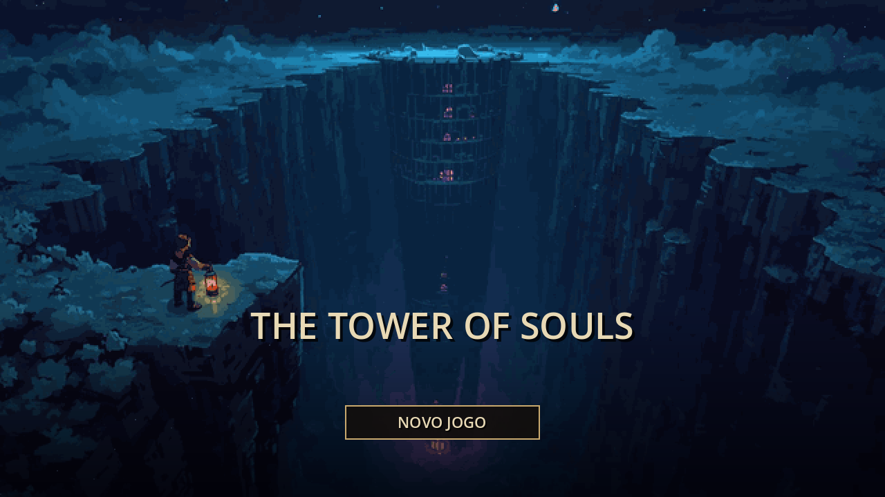
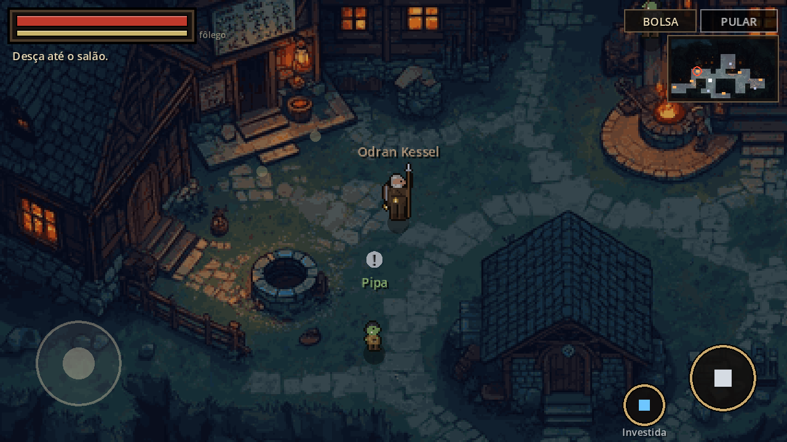
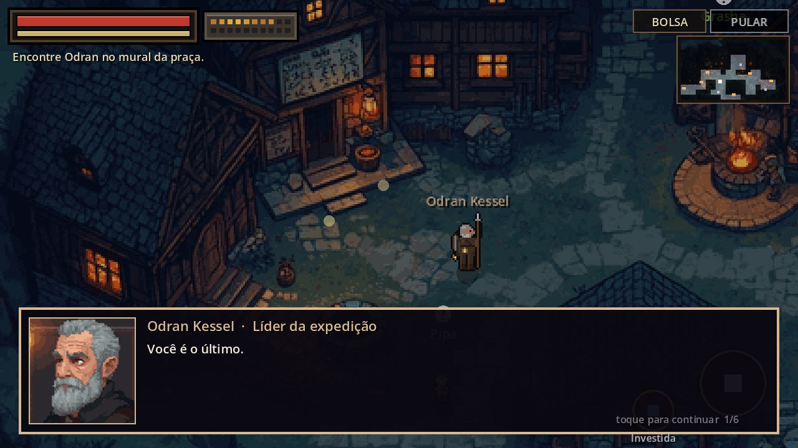
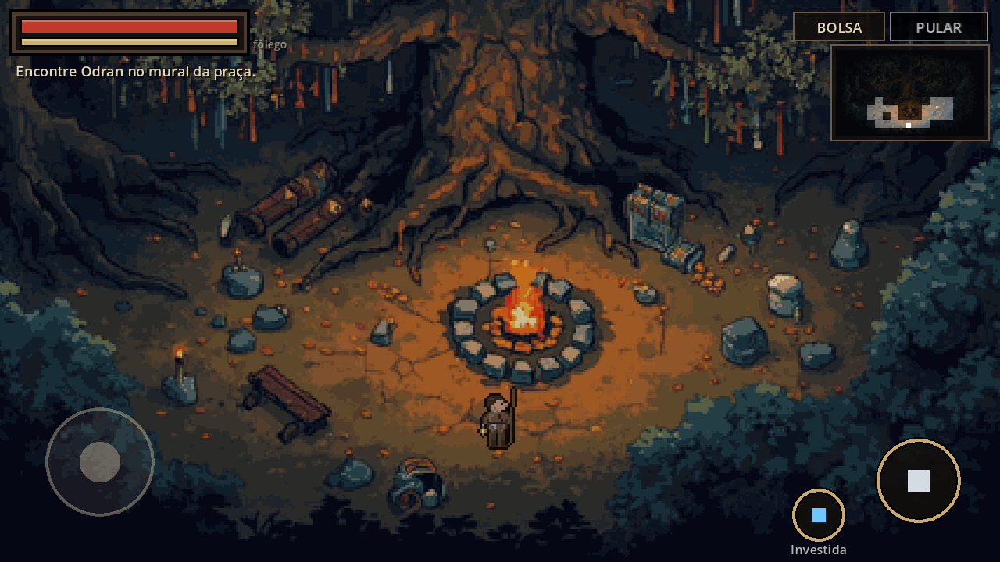
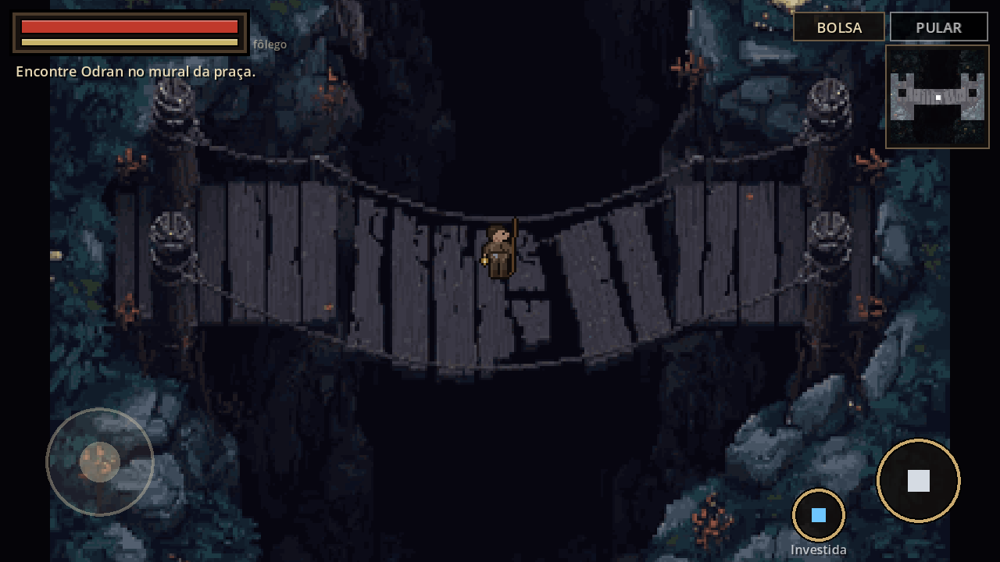
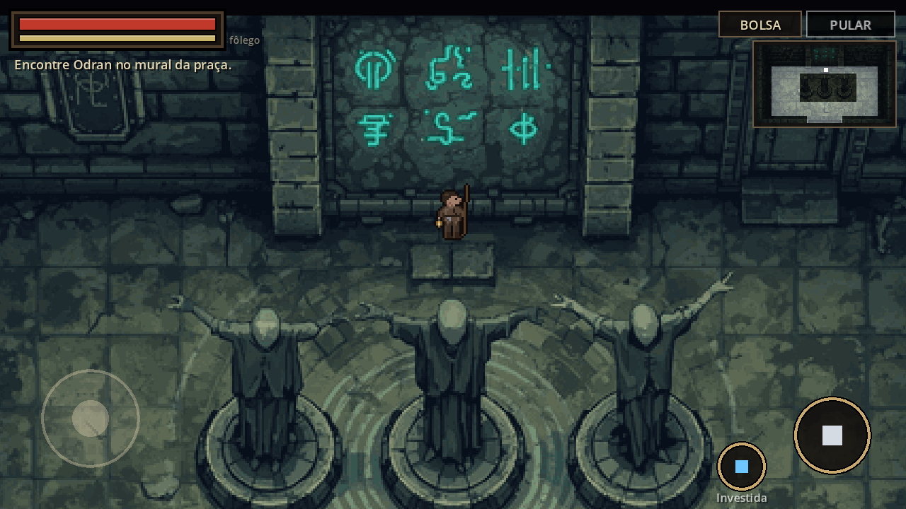

# The Tower of Souls — Prólogo

RPG de ação em pixel art para celular (Android), feito em **Godot 4.7**.
Esta é a versão de demonstração: o **prólogo completo**, do primeiro despertar até o fim do Ato VI.

## A história

Ninguém sabe quem ergueu a Torre. Seus andares não sobem: descem. Dizem que, quando alguém morre,
a alma vai para a Torre, e que só uma segunda morte, lá dentro, a deixa descansar.

Você é só mais um explorador de Beiral, a vila na borda da Fenda. Sem título. Sem lenda.
No dia da expedição, você desce com o grupo de Odran Kessel... e o que encontra lá embaixo muda tudo.

## O que tem no prólogo

- Seis atos jogáveis: a vila de Beiral, o Bosque Torto, a Ponte Partida, as Ruínas Sem Nome, a Câmara Sem Medida e o que vem depois.
- Cenários pintados em pixel art, interiores para explorar e um minimapa.
- Companheiros que lutam ao seu lado, diálogos com retratos e trilha sonora própria.

| | |
|---|---|
|  |  |
|  |  |
|  | |

## Como instalar (Android)

1. Abra a página de **[Releases](../../releases)** e baixe o arquivo `The-Tower-of-Souls-prologo.apk`.
2. Abra o arquivo no celular. Se o Android perguntar, permita instalar apps desta fonte ("fontes desconhecidas").
3. Jogue com o celular deitado.

> É uma versão de teste, assinada com a chave de depuração do Godot. Ela ainda não está na Play Store.

## Controles

- **Andar:** arraste o dedo no lado esquerdo da tela.
- **Atacar / Falar / Examinar:** botão grande à direita.
- **Investida:** botão menor (gasta a barra azul).
- **Bolsa:** botão no topo.
- **Pular:** pula a expedição e leva direto ao despertar.

## Status

Prólogo completo. Ao terminar, o jogo mostra "continua..." e volta ao menu. Os próximos capítulos estão em desenvolvimento.
